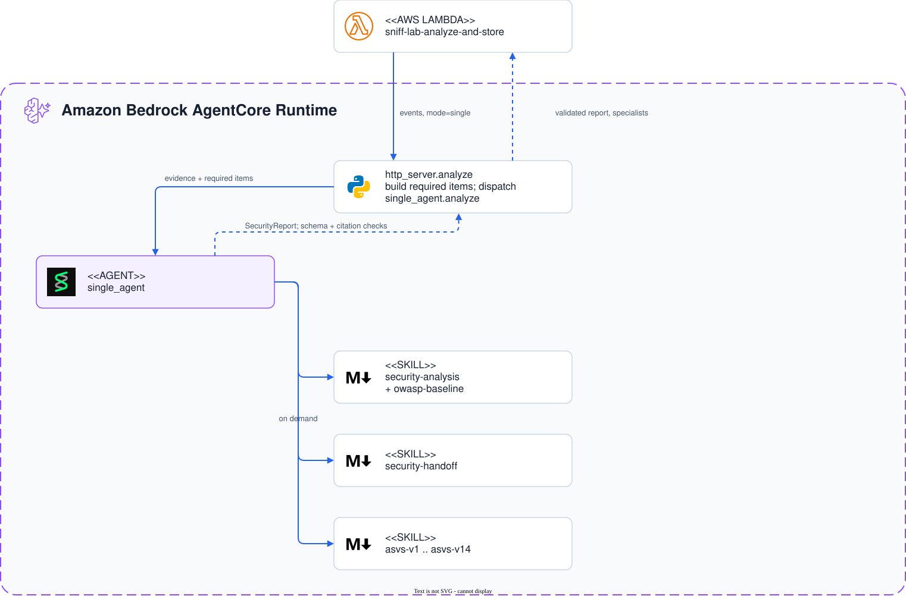

# sniff-lab

Demo: intercept traffic locally, scan it with ZAP offline, let agents triage the sanitized result in AWS Security Hub.
Only sanitized findings leave the host; raw captures stay local. Synthetic data only (`student` / `demo-password`).
Intentionally insecure: never expose publicly.

## Use case

An attacker on the network path (MITM) can read cleartext logins and tokens. A security team wants to know that
from traffic evidence without handling the secrets. Capture traffic, scan it, send only a sanitized summary to
agents, and get prioritized, human-reviewed fixes in Security Hub.

| Tool | Role |
| --- | --- |
| mitmproxy | Sits between client and demo server (the "attacker"). Shows cleartext passwords live and records every exchange. |
| HAR | Standard file format of the recorded traffic. Raw, contains secrets, stays local. |
| ZAP | Passive scanner: reads the HAR offline (no replay, no attacks) and reports weaknesses such as missing HSTS or cookie flags. |
| Sanitizer (`zap/findings.jq`) | Reduces the ZAP report to rule IDs, counts, paths and parameter names. No values. |
| Agents + Security Hub | Group findings, explain the attack chain and propose fixes. Humans decide. |

## Architecture


| `single` | `orchestrator` | `graph` |
| --- | --- | --- |
|  |  |  |

## Prerequisites

Docker Compose, Make, Python 3. For the cloud part: Terraform >= 1.5, AWS CLI login, Docker buildx (ARM64), Bedrock + AgentCore access (default `eu-central-1`).

## Demo steps

**0. One-time cloud deploy** (skip for local-only)

```bash
export AWS_PROFILE=my-existing-profile
make terraform-apply
```

**1. Start the lab**: also sends the demo traffic and publishes sanitized events to AWS.  It starts from clean volumes (`compose-down`).

```bash
make compose
```

**2. Attacker view (MITM)**: open http://localhost:8081/?token=demo (mitmweb).
Show the password in the cleartext `POST /login`, the session cookie, and `?token=` in the URL.

**3. ZAP reports** (wait ~60 s for the scan, then):

```bash
make zap-reports
```

Open `zap/private/report.html` (or `report.md` / `report.json`). These are the raw, human-readable ZAP reports:
they contain URLs and evidence, so they stay local.

**4. What leaves the host**: show the sanitized event (no URLs, values or bodies). The publisher deletes it after sending, so run `docker compose stop publisher` right after `make compose` to keep it queued:

```bash
docker compose exec zap sh -c 'cat /events/*.json' | head -c 2000
```

**5. Agent triage**: Security Hub CSPM, Findings (`terraform output security_hub_console_url`).
Titles start with `[single]`, `[orchestrator]`, `[graph]`: same evidence, three agent architectures.
Full reports: S3 `results/<mode>/<event_id>.json`; render one as Markdown:

```bash
python3 tools/report.py results/single/<event_id>.json > review.md
```

**6. Map ZAP report to Security Hub**: the join key is the ZAP rule (plugin) ID.
In the ZAP report find the alert and its plugin ID (HTML report: "Plugin Id" per alert):

```bash
grep -iE 'plugin|^#+ ' zap/private/report.md | head -40
```

In Security Hub, open the finding and read `ProductFields`: `rule_ids`, `rule_names`, `affected_paths`, `schemes`,
`instance_count`, `event_id`. Or query by rule ID:

```bash
aws securityhub get-findings --region eu-central-1 --query 'Findings[].[Title,ProductFields.rule_ids,ProductFields.affected_paths]' \
  --filters '{"ProductFields":[{"Key":"rule_ids","Value":"<plugin id>","Comparison":"CONTAINS"}]}' --output table
```

Talking points: ZAP report = full detail (URLs, evidence, local only). Security Hub = same rule, grouped by shared fix, with paths/schemes/param names only, plus owner, fix and retest. One finding covers several rules, so match on `rule_ids`.

**7. Fix and re-scan** (optional): fix the server, rerun `make compose`. Each run is analysed on its own; there is no comparison with earlier scans.

## Stop and clean up

```bash
make compose-down      # deletes volumes
make terraform-destroy # also deletes the results bucket content
```

## Notes

- Raw HAR, ZAP reports and scan logs stay in the private `capture` volume; never upload them anywhere.
- Sanitized events hold rule IDs, risk/confidence/counts, allowlisted paths, http/https, parameter names, and HTTP/HTTPS request counts. No custom severity rules: agents judge impact from ZAP findings.
- ZAP never sees TLS certificates (HAR has none). The sanitized event only carries `tls_client_rejected`, the number of clients that refused the certificate; it does not prove the certificate is self-signed.
- ZAP does passive checks on imported HAR only: no crawling, no active scanning, no network.
- Scans run every 60 s on new traffic (`SCAN_INTERVAL`); allow 2-5 min per snapshot for all three agent modes.
- Agents recommend; humans decide. Missing alerts never close findings.
- `make help` lists all targets.
