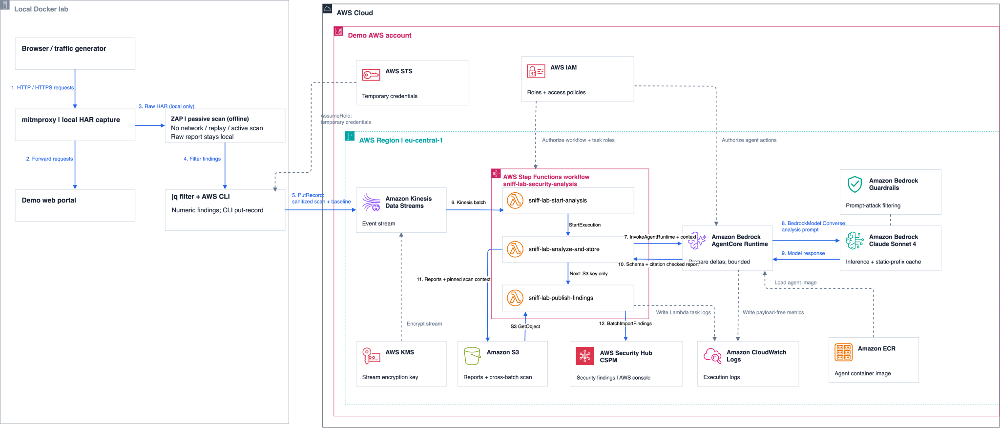

# sniff-lab

Local demo traffic, offline ZAP scanning, and agent-led security triage on AWS.
Only sanitized findings leave the host; raw captures stay local.

## Architecture



| Architecture | Diagram | Editable |
| --- | --- | --- |
| Overview | [SVG](docs/architecture.svg) | [Draw.io](docs/architecture.drawio) |
| Single agent (`single`) | [SVG](docs/architecture-alternative-1.svg) | [Draw.io](docs/architecture-alternative-1.drawio) |
| Model-directed orchestrator (`orchestrator`) | [SVG](docs/architecture-alternative-2.svg) | [Draw.io](docs/architecture-alternative-2.drawio) |
| Parallel reviews (`graph`) | [SVG](docs/architecture-alternative-3.svg) | [Draw.io](docs/architecture-alternative-3.drawio) |

### Single agent (`single`)


### Model-directed orchestrator (`orchestrator`)


### Parallel reviews (`graph`)


## Agent robustness and cost controls

Each snapshot fans out to `single`, `orchestrator`, and `graph` in three independent
workflow executions. All receive the same evidence and event-pinned baseline;
one mode failing does not cancel the others. All report-producing agents use Strands structured
output backed by the existing JSON Schema; evidence citation checks still run
after generation. Invalid, truncated, or budget-exhausted reports are not published.
Single requests allow two turns and one failed structured-output attempt;
orchestrator requests share an eight-turn budget with nested agents. Token limits
are checked between calls, not hard billing caps. Per-response output stays capped
at 6,000 tokens. Graph nodes and specialists retain hard call caps (two each).

Terraform `prompt_cache_enabled` defaults to `true`. Strands automatic model
detection caches only static system prefixes with a five-minute TTL, not evidence
messages. Disable for unsupported models. Model-specific minimum token thresholds
still apply; small prompts may produce no cache hits. Caching is not scan memory.

Runtime emits allowlisted JSON metrics: latency, token/cache usage when provided,
tool-failure counts, completion/budget outcome, context schema version and baseline
availability. SDK log propagation and OpenTelemetry export are disabled in the
runtime to avoid exporting evidence, reports or tool payloads. No new AWS telemetry
permissions or tracing backend required. Do not enable Bedrock invocation-body
logging for this demo.

AgentCore Memory remains intentionally unused: there is no authenticated
human-decision ingestion path. Add it when approved triage decisions need semantic
retrieval; namespace by tenant/asset, retain provenance and expiry, and never use
model-extracted memories as authoritative scan baselines or action permissions.

## Local demo

Make, Docker Compose and Python 3 required. Run all commands from the root of your
cloned repository.

```bash
make compose
python3 tools/traffic.py -n 5
```

Compose generates the demo's self-signed certificate before starting the server.
`make compose` first runs Compose `down`, then rebuilds and starts services.
Cleanup preserves volumes, including captures and unpublished events.
Proxy stays running; every 60 seconds, new completed traffic triggers an offline
ZAP scan and sanitized event generation. No separate capture or scan commands.

| Address | Role |
| --- | --- |
| http://localhost:8082 | Demo portal over HTTP |
| https://localhost:8083 | Demo portal over HTTPS; proxy certificate warning expected |
| http://localhost:8081/?token=demo | mitmweb traffic inspection |

Use synthetic credentials only, e.g. `student` / `demo-password`. The portal
accepts any non-empty credentials. Do not expose this intentionally insecure demo
publicly. Raw HAR contains credentials; never upload it or raw ZAP reports.

Keep `EXPORT_EVENTS=0` (default); legacy per-exchange export is not needed.
Stop with `make compose-down` (also stops an enabled publisher).

### Capture and offline ZAP scan

Run on a Docker-capable host; Dev Container has no Docker socket. Compose includes
all scanner/conversion dependencies. `SCAN_INTERVAL` (default `60` seconds) and
`CAPTURE_MAX_FLOWS` (default `1000`) can be set in `.env` before startup.

Snapshots use mitmproxy's native HAR exporter and retain the latest completed
HTTP responses, up to the configured flow count. The proxy stays live while ZAP
scans an immutable snapshot. Idle periods produce no new scans. Snapshots overlap;
counts describe the rolling window, not new incidents since the last scan.
Older flows leave the window; absent alerts do not prove a fix. Failed scans never
queue an event; the next snapshot retries scanning the current window.
Flow count is not a byte limit; keep request bodies small. The mitmweb inspection
view also retains traffic in memory; restart the proxy during long demo sessions.

ZAP 2.17.0 imports HAR without replay, crawling or active scanning. Its container
has no network or AWS credentials; local scan/conversion makes no cloud/model calls.
Raw HAR, ZAP reports, and scan logs stay in the private `capture` Docker volume;
never upload them to an LLM, cloud storage, issue tracker or Git. Scan details stay
in `/zap/wrk/scan.log` inside the ZAP container, not Compose logs.

Only sanitized events enter the separate `events` volume. Each contains numeric rule
IDs, risk/confidence/counts, asset ID, timestamp, SHA-256 event ID and optional
baseline, not URLs, headers, bodies or matched evidence. Agents cannot infer affected
endpoints, HTTP/HTTPS exposure or comparable coverage from it. Empty findings do not
prove safety; require local review. ZAP detects weaknesses,
not arbitrary secret leaks or malicious MITM attribution.

Without AWS publishing, events remain queued locally. At 100 queued events,
scanning pauses rather than discarding unpublished results. Raw capture and queued
events survive `docker compose down`; `docker compose down -v` deletes both.

## AWS deployment

### Prerequisites

- Terraform >= 1.5, Python 3.12, AWS CLI, Docker with ARM64 buildx support.
- AWS deployment credentials with service-creation, IAM role-passing, and `bedrock:GetInferenceProfile` permissions.
- AgentCore Runtime and Bedrock model access in selected region; default `eu-central-1` with Claude Sonnet 4 EU inference profile.
- Your existing AWS login, with permission to assume the publisher role created by this stack.
  Role/SSO deployments also need `iam:GetRole` to resolve the login's underlying IAM role.

**No separate lab role or new IAM user is needed.** Terraform creates the publisher
role and limits it to `kinesis:PutRecord` on this demo's stream. Your existing user
or login role is discovered automatically and trusted to assume it. No ARN lookup,
separate publisher profile, or credentials file is needed. Use the same login for
deployment and running the demo. An optional `publisher_principal_arn` override is
only needed if a different existing identity should be trusted. Changing deployment
identity on a later apply changes this trust unless that override is set.

Use a dedicated demo account. Terraform owns regional Security Hub CSPM enrollment;
destroying this stack disables it, including imported enrollment. AWS charges apply.

### Roles and Docker credentials

Terraform creates and assigns all application roles; no IAM users or long-lived
access keys are created. With the default stack name:

| Role | Used by | Permissions |
|---|---|---|
| `sniff-lab-publisher` | Local publisher container, through temporary STS credentials | `kinesis:PutRecord` on this stack's stream only |
| `sniff-lab-security-analysis` | Step Functions | Invoke analysis/report Lambdas and import Security Hub findings |
| `sniff-lab-agent` | AgentCore Runtime | Pull its ECR image, invoke configured Bedrock models, apply guardrail, write logs |
| `sniff-lab-start-analysis` | Ingestion Lambda | Read stream, start workflows, write failed-batch destination |
| `sniff-lab-analyze-and-store` | Analysis Lambda | Invoke AgentCore and read/write report/context objects in S3 |
| `sniff-lab-publish-findings` | Report Lambda | Read reports from S3 and write logs |

One AgentCore execution role is enough: `single`, `orchestrator`, and `graph` share
one runtime and need the same AWS permissions. Step Functions has a separate role.
AWS assumes service roles automatically; their credentials never go to local Docker.
The AgentCore container receives its runtime role credentials from AWS, not Compose.

`make compose COMPOSE_PROFILES=aws` reads `publisher_role_arn`, `region`, and
`stream_name` from Terraform outputs, then assumes only the publisher role using
your existing host login. It passes the resulting temporary access key, secret,
and session token only to the publisher container. A role ARN alone is not a
credential. No copying ARNs, configuring another profile, or mounting AWS config.
Use the Make target rather than bare Compose for this automatic credential setup.
Run `make terraform-output` to inspect `publisher_role_arn` and `service_role_arns`;
neither output contains credentials.

### Deploy with Terraform

1. Select the AWS CLI profile you already use. Replace `my-existing-profile` with
   its name (`default` if you use the default profile). Keep this exported for all
   deployment commands below:

   ```bash
   export AWS_PROFILE=my-existing-profile
   ```

   Skip the export if you already use the default credential chain. For SSO, run
   `aws sso login` for your selected profile first. Region defaults to `eu-central-1`;
   no tfvars file is required.

2. Preview, then deploy. Apply still requires confirmation:

   ```bash
   make terraform-plan
   make terraform-apply
   ```

   Both targets initialize Terraform and package Lambda automatically. No separate
   `make package` step. During apply, Terraform creates ECR, builds and pushes the
   ARM64 runtime image, resolves its digest, and deploys AgentCore and the pipeline
   in the same apply. Plan does not build images or create AWS resources.

   Docker/buildx, Python, and AWS CLI must be available where Terraform runs.
   The image build is a Terraform `local-exec` provisioner: source changes trigger
   a new immutable tag; unchanged sources reuse their image. Interrupted applies
   reuse an already-pushed tag. ECR login uses temporary Docker config that is
   removed after the build. The runtime always references an image digest.

   If Security Hub is already enabled, import it before applying:

   ```bash
   make terraform-init
   terraform -chdir=aws/terraform import aws_securityhub_account.demo \
     "$(aws sts get-caller-identity --query Account --output text)"
   ```

Run `make` for targets, including `terraform-output`, `terraform-destroy`, `compose`,
and `compose-down`. Optional overrides use `TF_VAR_region`, other `TF_VAR_*` values,
or `TFVARS=other.tfvars` (relative to `aws/terraform`). The image build's AWS CLI uses
the host login, so use the same account/profile as Terraform; provider-only role
assumption is not forwarded to local commands. An optional `image_uri` override
uses a prebuilt image and skips the embedded build. Remove legacy `image_uri`
settings to enable automatic image builds.

### Use

After deployment, start the complete continuous pipeline with the same existing
AWS login. No separate publisher profile or `.env` setup is needed:

```bash
make compose COMPOSE_PROFILES=aws
```

Or select your existing profile at invocation:

```bash
make compose COMPOSE_PROFILES=aws AWS_PROFILE=my-existing-profile
```

Make reads publisher role ARN, stream name, and region from Terraform outputs,
then uses host AWS CLI `sts assume-role` to obtain restricted one-hour credentials.
SSO and host `credential_process` helpers stay on the host. Only the publisher
receives the temporary credentials; AWS config is never mounted. Neither Terraform
state nor generated files receive temporary credentials. Output lookup and role
assumption must succeed before existing containers are stopped; then Compose runs
`down` followed by `up`. Stream and region from Terraform override old `.env` values.

Terraform targets use the same host credential chain, including
`AWS_PROFILE=my-existing-profile make terraform-apply`. If role assumption is denied,
check source-role `sts:AssumeRole` permissions, organization policies, and permission
boundaries. Terraform cannot bypass those restrictions. Existing deployments should
remove the old `publisher_principal_arn` tfvars entry to enable identity discovery,
then run `make terraform-apply` to update trust and add the region output.

Use a least-privilege publisher role with temporary credentials, not deployment/admin
credentials. Docker administrators can inspect container environment variables;
do not share Docker access with untrusted users or print `docker compose config`
with credentials loaded. Temporary credentials expire after one hour and do not
refresh inside the container; rerun the Make command to obtain a new session.
Renew your host SSO login first if needed. Raw capture is never
mounted in the publisher. AWS charges apply; enabling this profile automatically
uploads sanitized events, including events queued before publishing was enabled.

Publisher retries failures every 10 seconds using the same saved event ID and
deletes each queued event only after Kinesis accepts it. Delivery is at least once;
AWS deduplicates by event ID. Kinesis acceptance is not completed analysis.
Check progress with `docker compose --profile aws logs -f zap publisher`.
Review recommendations in **Security Hub CSPM → Findings**
using output `security_hub_console_url`; full reports stay in `results_bucket` S3 bucket.
Security reviews recommendations; engineers apply fixes and recapture. Missing alerts
do not auto-close findings, and agents do not perform autonomous remediation.

Finding titles start with `[single]`, `[orchestrator]`, or `[graph]`. Filter
`GeneratorId` by `sniff-lab/single`, `sniff-lab/orchestrator`, or `sniff-lab/graph`.
Each finding also carries `ProductFields.analysis_mode` and `ProductFields.event_id`;
compare matching event IDs because modes finish at different times. Mode-specific
finding IDs prevent cross-mode overwrites; S3 retains reports under
`results/<mode>/<event_id>.json`. Continuous scans update findings per mode/asset/fix
group, not one new finding per snapshot. Older same-mode executions can finish late;
use S3 event reports for exact snapshot comparisons rather than assuming the console
shows a synchronized set. All three modes incur model usage for each snapshot;
allow 2–5 minutes between snapshots for a live demo and monitor service quotas.

When upgrading, remove the obsolete `analysis_mode` setting from existing tfvars.

### Baselines

Scan analysis shares seven-day S3 context across executions. Without an embedded
baseline, each scan pins the latest accepted earlier scan for its demo asset.
Retries retain pinned context; only validated, saved analyses advance latest context.
All agents receive one precomputed comparison; absent alerts never prove resolution.
Saved results retain original evidence, pinned context and deterministic deltas.
Automatic baselines assume one demo scan scope per asset, not verified comparability.

The continuous pipeline uses these automatic AWS baselines; it does not embed a
local baseline. Rolling capture windows are not verified comparable scan scopes.

### Cleanup

Export any needed results, then explicitly empty the results bucket and ECR repository.
The stack refuses to delete them while nonempty. Keep Terraform state until cleanup succeeds.

```bash
make terraform-destroy
```
